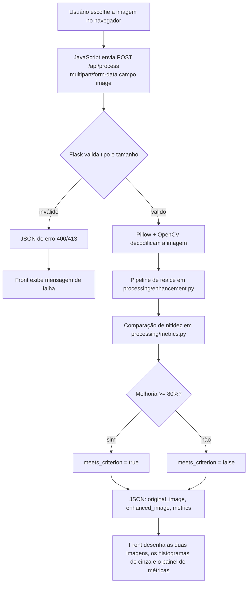

# Realce de texto em documentos

Sistema web local para a disciplina de **processamento de imagens e sinais**. Recebe a imagem de um documento, realça o texto para aumentar a legibilidade e compara a nitidez da imagem original com a imagem gerada.

O critério de avaliação adotado no backend considera a imagem **melhor** quando o texto fica **pelo menos 80% mais nítido**.

## Arquitetura

| Camada | Tecnologia | Papel |
| --- | --- | --- |
| Front-end | HTML, CSS e JavaScript | Upload da imagem, estado de processamento, imagens lado a lado e histogramas em tons de cinza |
| Back-end | Python 3, Flask, OpenCV, NumPy, Pillow | Pipeline de realce, métricas de nitidez, histogramas de cinza e API JSON |
| Entrega | Execução local em `http://127.0.0.1:5000` | Demonstração em aula sem deploy na nuvem |

```
.
├── app.py                      # API Flask e página inicial
├── processing/
│   ├── enhancement.py          # Pipeline de realce do documento
│   └── metrics.py              # Nitidez (critério de 80%) e histogramas de cinza
├── templates/index.html
├── static/style.css
├── static/app.js
├── requirements.txt
├── README.md                   # Este arquivo (visão técnica)
└── COMO_FUNCIONA.md            # Explicação para quem não é da área
```

## Pipeline de processamento

1. **Decodificação** — a imagem enviada é lida com Pillow e convertida para BGR (OpenCV).
2. **Tons de cinza** — o texto é tratado como variação de luminância, não de cor.
3. **Deskew** — correção de pequena inclinação pelo ângulo do retângulo mínimo dos pixels de texto.
4. **Redução de ruído** — `fastNlMeansDenoising` brando (`h=7`) para suavizar granulação sem borrar letra pequena.
5. **Ampliação 2x** — o limiar roda em resolução maior (exceto fotos já grandes) para o traço miúdo ter mais pixels.
6. **Contraste local (CLAHE)** — equalização adaptativa com `clipLimit=2.0`.
7. **Nitidez leve (unsharp mask)** — `amount=0.8`, para reforçar borda sem halo grosso.
8. **Binarização adaptativa** — limiar gaussiano local (`block_size=21`). Sem morfologia, para não engrossar o traço.
9. **Redução com antialias** — volta ao tamanho original com `INTER_AREA`, gerando bordas cinza suaves em vez de escada de pixels.
10. **Métricas** — Laplaciano + Tenengrad no original e no resultado; percentual de melhoria.
11. **Histogramas** — contagem de pixels por intensidade 0–255 na original convertida para cinza e na imagem realçada.
12. **Resposta** — as duas imagens em PNG Base64, os histogramas e o veredito do critério de 80%.

## Fluxo da requisição



### Contrato da API

`POST /api/process`

- **Entrada:** arquivo no campo `image`.
- **Saída de sucesso:**

```json
{
  "filename": "documento.jpg",
  "original_image": "<png em base64>",
  "enhanced_image": "<png em base64>",
  "metrics": {
    "original": { "laplacian": 0, "tenengrad": 0, "contraste_rms": 0, "nitidez": 0 },
    "enhanced": { "laplacian": 0, "tenengrad": 0, "contraste_rms": 0, "nitidez": 0 },
    "improvement_percent": 0,
    "threshold_percent": 80,
    "meets_criterion": true,
    "histograms": {
      "original": [0, 0, 0],
      "enhanced": [0, 0, 0]
    },
    "verdict": "O texto ficou pelo menos 80% mais nítido."
  }
}
```

A **nitidez combinada** é `0,6 × variância do Laplaciano + 0,4 × Tenengrad`. A melhoria percentual é:

```
melhoria = ((nitidez_realçada − nitidez_original) / nitidez_original) × 100
```

Se `melhoria >= 80`, o backend classifica o resultado como texto pelo menos 80% mais nítido.

`metrics.histograms.original` e `metrics.histograms.enhanced` são listas de 256 inteiros: o índice é a intensidade (0 = preto, 255 = branco) e o valor é a quantidade de pixels. A original usa a mesma conversão `BGR → cinza` do restante das métricas.

## Como executar o projeto

Requisitos: **Python 3.10 ou superior** e pip.

No PowerShell, dentro da pasta do projeto:

```powershell
python -m venv .venv
.\.venv\Scripts\Activate.ps1
pip install -r requirements.txt
python app.py
```

No prompt do Windows (cmd):

```cmd
python -m venv .venv
.venv\Scripts\activate.bat
pip install -r requirements.txt
python app.py
```

Abra o navegador em [http://127.0.0.1:5000](http://127.0.0.1:5000), envie a foto de um documento e aguarde o par original / realçado.

Para encerrar o servidor, use `Ctrl+C` no terminal.

### Problemas comuns

- **`Activate.ps1` bloqueado:** execute `Set-ExecutionPolicy -Scope CurrentUser RemoteSigned` ou use o `activate.bat` do cmd.
- **`python` não reconhecido:** tente `py -3` no lugar de `python`.
- **Foto muito grande:** o limite é 12 MB.

## Escopo da entrega

Página simples para rodar na máquina do grupo. Não há autenticação, banco de dados nem OCR: o objetivo é o **processamento da imagem** e a **comparação objetiva de nitidez**.
